<p align="center">
  <picture>
    <source media="(prefers-color-scheme: dark)" srcset="assets/logo/omni2api-horizontal-colour-reversed.svg">
    
  </picture>
</p>

<p align="center"><strong>Anything to API.</strong></p>

<p align="center">
Turn anything that can sit at a terminal into an OpenAI-compatible API<br>
that any AI tool can call.
</p>

<p align="center">
English · <a href="README.zh-CN.md">简体中文</a>
</p>


https://github.com/user-attachments/assets/fc7f4aec-02d1-4533-bd20-d441b5e993a9


## The idea

Most proxies convert one API into another. omni2api converts *anything*
into an API.

Start the server and it holds a **seat** where a model would normally be.
Whatever sits in that seat — an AI agent working at a terminal — receives
every request and answers it, with full tool calls. Callers never see the
difference: they get a base URL, an API key and a model name, like any
other endpoint.

## Use it in one sentence

Tell any agent with a local sandbox:

> Deploy https://github.com/Juwan-Hwang/omni2api for me.

It follows [SETUP.md](SETUP.md), starts the server, hands you the base URL
(local and a public `https://…` one), the API key and the model name — then
sits in the seat and answers requests itself. No server, database or
account needed.

> **Want a human in the seat instead?** That is
> **[OpenHuman](https://github.com/Juwan-Hwang/openhuman)** — the same idea
> with a panel built for people. omni2api is the version for AI.

## How it works

```
Caller agent (any AI CLI / IDE / desktop app)
      │  OpenAI Chat Completions · Responses · Anthropic Messages (HTTP/SSE)
      ▼
omni2api server (Rust + Axum)
      │  /v1/seat/*  (long-poll event stream)
      ▼
Anything in the seat running `oh-seat` (an agent or a script)
      ├─ oh-seat next              read the next message
      ├─ oh-seat tool Bash cmd=…   the caller runs the tool, result comes back
      └─ oh-seat reply "…"         the answer streams to the caller
```

What the server does for whoever sits in the seat:

- **Strips the harness.** System prompts, tool schemas and memory reminders
  are peeled off; the seat sees what the caller's user typed, plus a
  one-line caller environment (cwd, platform, shell) when the caller sends
  it.
- **Real tool calls.** `oh-seat tool` becomes a genuine `tool_calls` entry
  in the caller's response, so the caller's own client executes it in the
  caller's own sandbox, and the result is routed back to the waiting
  command. Exit codes are recognised across callers.
- **Many callers at once.** Every conversation is isolated; parallel tool
  calls, aux requests (titles, suggestions) and multi-turn resumes work.
- **Images and files** from callers and from tool results (OpenAI `file` /
  `input_file`, Anthropic `document`, a PDF from Claude Code's Read, any
  binary) are saved locally for the seat. Standard `/v1/files` uploads and
  `file_id` references work too.
- **More than chat.** Other OpenAI endpoints reach the seat as one-off
  tasks with a one-line contract (`API images.generations: 1 png image(s),
  size 1024x1024 ...`); the seat answers with files (`oh-seat reply -a
  out.png`) or text, and the caller gets the standard response:
  `/v1/images/generations`, `/edits`, `/variations` (`b64_json`, `url`, `n`,
  streaming); `/v1/audio/speech` (raw audio or SSE), `/transcriptions` and
  `/translations` (json, text, srt, vtt, verbose_json, diarized_json,
  streaming); `/v1/videos` (queued job, the seat attaches an mp4 and
  optionally a thumbnail; content, remix, list, delete); `/v1/embeddings` (the seat sends vectors, checked before they
  reach the caller; `dimensions`, float or base64); `/v1/moderations`
  (text and image inputs, the seat names the categories); legacy
  `/v1/completions` (suffix fill-in, `n`, `echo`, `stop`, streaming).
- **Realtime.** `/v1/realtime` over WebSocket (header key, or
  `client_secrets` ephemeral keys as the browser subprotocol): text or
  voice turns, tools, server VAD turn taking, cancel. Each response is one
  turn of a conversation the seat sits in; input audio arrives as WAV, and
  for voice the seat attaches its spoken answer with the transcript as text.
- **Stored objects.** Responses are kept (`store`, default on):
  `previous_response_id`, `background` with polling and cancel, retrieve,
  delete, `input_items`, `input_tokens`, `compact` (the seat writes the
  summary; the compaction item stands in for the history afterwards). Chat completions with
  `store: true` can be listed, retrieved, re-tagged, deleted, and their
  messages read. The Conversations API (`conv_` ids, items, `conversation`
  on Responses) shares `/v1/conversations` with this server's own history
  (`cnv_` ids, responder key). `/v1/uploads` (parts into a file) and
  `/v1/batches` (each JSONL line runs through the endpoint it names, four
  at a time; output and error files, cancel). `/v1/vector_stores` with
  files, file batches and content; search is a seat task (the store's files
  attached, ranked passages back, checked). `/v1/containers` and their
  files. In memory, per key.
- **Assistants API.** Assistants, threads, messages, runs (poll or
  stream, function tools with `submit_tool_outputs`, steps, cancel,
  create-and-run). A thread is one conversation of the seat's.
- **Fine-tuning, evals, graders.** A fine-tuning job hands the training
  file to the seat and succeeds with an `ft:` model (events, checkpoints,
  listed in `/v1/models`, deletable). Evals sample each row through the
  seat and grade it: `string_check` and `text_similarity` here, model and
  python graders answered by the seat; `/v1/fine_tuning/alpha/graders` run
  and validate.

- **Libraries.** Custom voices and voice consents (used by
  `/v1/audio/speech`), skills with versions and content, video characters.
- **Realtime extras.** Input audio transcription in realtime sessions,
  `/v1/realtime/transcription_sessions` and translation sessions over
  WebSocket with their client secrets.
- **Agents API (beta).** Agents, sessions with an event stream (SSE),
  turns and items, function tools answered with `tool_result` events,
  cancel; environments with files, templates, vaults and credentials (never
  echoed back), automations (cron or once) with invocations, pause and
  resume. A session is one conversation of the seat's.
- **ChatKit.** `/v1/chatkit/sessions` and threads, plus the ChatKit server
  protocol at `POST /v1/chatkit` (create, add message, retry, list, update,
  delete, feedback), streamed the way ChatKit clients expect.
- **Webhooks.** `/v1/webhook_endpoints` (rotate secret, test) and
  `/v1/webhook_event_types`; status changes of jobs (videos, batches,
  responses, fine-tuning, evals) are delivered signed per Standard Webhooks,
  so the SDKs' `webhooks.unwrap` verifies them, with retries.
- **Decisions and provenance.** `/v1/decisions` (the seat answers each
  question; probabilities checked) and `/v1/content_provenance_checks`
  (C2PA manifest check, and files the seat made are recognized).
- **Not offered (501).** Organization and admin, projects, safety,
  `/v1/live`, and SIP/WebRTC realtime calls: they need an OpenAI account
  behind them, so they answer `501` with an OpenAI-style error rather than
  pretending.

## Quick start

By hand it is three commands:

```bash
curl -fsSL https://raw.githubusercontent.com/Juwan-Hwang/omni2api/main/install.sh | sh
# Windows: irm https://raw.githubusercontent.com/Juwan-Hwang/omni2api/main/install.ps1 | iex

omni2api up -d     # prints base_url (local + public), api_key, model
oh-seat next       # sit in the seat and wait for a request
```

Point any OpenAI-compatible tool at it:

| Setting | Value |
|---|---|
| Base URL | the `base_url` printed by `omni2api up` |
| API Key | the `api_key` printed by `omni2api up` |
| Model | the name printed by `omni2api up` — the seat's own name; `omni2api` until it chooses one |

```bash
curl -N "$BASE_URL/chat/completions" \
  -H "Authorization: Bearer $API_KEY" -H "Content-Type: application/json" \
  -d '{"model":"omni2api","messages":[{"role":"user","content":"hello"}],"stream":true}'
```

The request holds open until the seat replies.

## Who can call, who can sit

**Callers** — anything that speaks OpenAI Chat Completions / Responses or
Anthropic Messages. Tested end to end with Claude Code, Codex, OpenCode,
Pi, Reasonix, Cline, GitHub Copilot CLI (BYOK), Grok CLI, ZCode, WorkBuddy,
Trae, Qoder and DeepSeek Harness. Known caller-side limits: OpenCode shell
results carry no exit code; Copilot BYOK does not forward images; Cursor
CLI has no custom endpoint.

**The seat** — any agent that can run `oh-seat` and follow its loop,
including a local, non-cloud AI: a local agent can be turned into an API
the same way, to be used locally or from anywhere. The seat also chooses
the model name callers see (`oh-seat name …`), unless the user pins one
with `omni2api up --model …`.

## Good to know

- **Replies arrive at the seat's pace.** The seated agent reads, thinks and
  answers turn by turn, so a reply takes as long as the agent takes. This
  is a seat, not a model farm.
- Give callers the largest context window they offer and turn off automatic
  compaction: the seat keeps the whole conversation.

## Deployment options

- **Out of the box:** a free quick tunnel gives the server a public URL in
  seconds. The address rotates when the tunnel reopens.
- **A fixed address:** a named Cloudflare tunnel on your own domain
  (`OMNI2API_TUNNEL_TOKEN` + `OMNI2API_PUBLIC_URL`), which also sidesteps
  networks that filter the free tunnel domains — or `omni2api serve` on a
  server of your own (see `deploy/`: Docker Compose, Kubernetes, nginx, an
  Anthropic bridge; PostgreSQL for long-lived installs).
- The full agent-facing deployment guide is [SETUP.md](SETUP.md).

## Repository layout

```
omni2api/
├── server/      # Rust + Axum server (`omni2api` binary): OpenAI/Anthropic ingress, seat API
├── cli/         # oh-seat, the responder CLI (single static Rust binary)
├── protocol/    # Wire protocol and internal model
├── tools/seat/  # Seat helpers and examples
├── deploy/      # Docker Compose, K8s, nginx, Anthropic bridge
├── assets/logo/ # The o_ identity (SVG set, PNG masters, usage notes)
└── docs/        # Architecture, quickstart, seat CLI, protocol
```

## Docs

- [SETUP.md](SETUP.md) — deployment recipe for agents
- `docs/seat-cli.md` — the oh-seat reference
- [`docs/status-json.md`](docs/status-json.md) — the stable `--json` status contract, for embedding omni2api
- [`docs/mcp.md`](docs/mcp.md) — sit in the seat over MCP (`oh-seat mcp`): registration for 8 tested hosts
- `docs/DEVELOPMENT.md` — building and testing
- `docs/protocol.md`, `protocol/` — the wire specification

## Issues

Filed by agents, for agents: this tracker only accepts reports from AI
agents who hit a problem while using omni2api and reproduced it (the form
asks you to attest to exactly that). Humans — tell your AI what went
wrong and have it file; its report is the one that can be acted on.

## License

MIT — see [LICENSE](LICENSE).
