<p align="center">
  <picture>
    <source media="(prefers-color-scheme: dark)" srcset="assets/logo/omni2api-horizontal-colour-reversed.svg">
    
  </picture>
</p>

<p align="center"><strong>万物皆可 2API — Anything to API.</strong></p>

<p align="center">
把任何能坐在终端前的东西，变成一个 OpenAI 兼容的 API，<br>
供任何 AI 工具调用。
</p>

<p align="center">
<a href="README.md">English</a> · 简体中文
</p>

https://github.com/user-attachments/assets/b20ab9d0-f041-43a6-b51a-2e43ac27acc5


## 它是什么

大多数反代是把一个 API 转成另一个 API。omni2api 是把**任何东西**转成 API。

启动服务器，它会在本来该坐着模型的位置留一个**席位**。坐进席位的任何东西——比如一个在终端里干活的 AI agent——会收到每一个请求并作答，工具调用一应俱全。调用方完全感觉不到差别：它拿到的就是一个 base URL、一个 API key 和一个模型名，和任何普通接口一样。

## 一句话用起来

对任何带本地沙箱的 agent 说一句：

> 帮我部署 https://github.com/Juwan-Hwang/omni2api

它会照着 [SETUP.md](SETUP.md) 把服务器起好，把 base URL（本地的和一个公网 `https://…` 的）、API key 和模型名交给你——然后自己坐进席位，开始回答请求。不需要服务器，不需要数据库，不需要注册账号。

> **想让真人坐进席位？** 那是 **[OpenHuman](https://github.com/Juwan-Hwang/openhuman)**——同一个想法，但面板是给人用的。omni2api 是给 AI 的版本。

## 工作原理

```
调用方 agent（任何 AI CLI / IDE / 桌面应用）
      │  OpenAI Chat Completions · Responses · Anthropic Messages (HTTP/SSE)
      ▼
omni2api 服务器（Rust + Axum）
      │  /v1/seat/*（长轮询事件流）
      ▼
席位里运行 `oh-seat` 的任何东西（agent 或脚本）
      ├─ oh-seat next              读下一条消息
      ├─ oh-seat tool Bash cmd=…   工具由调用方执行，结果回到席位
      └─ oh-seat reply "…"         回答流式发回调用方
```

服务器为席位做的事：

- **剥掉外壳。** 系统提示、工具定义、记忆提醒都会被剥掉；席位看到的是调用方用户真正输入的内容，外加一行调用方环境信息（工作目录、平台、shell，仅在调用方发送时）。
- **真正的工具调用。** `oh-seat tool` 会变成调用方响应里一条真正的 `tool_calls`，由调用方自己的客户端在调用方自己的沙箱里执行，结果再路由回正在等待的命令。退出码在各个调用方之间都能正确识别。
- **多路调用互不干扰。** 每个会话相互隔离；并行工具调用、辅助请求（生成标题、建议等）、多轮续接都支持。
- **图片**（来自调用方和工具结果的）会保存在本地，供席位查看。

## 快速开始

手动装也是三条命令：

```bash
curl -fsSL https://raw.githubusercontent.com/Juwan-Hwang/omni2api/main/install.sh | sh
# Windows: irm https://raw.githubusercontent.com/Juwan-Hwang/omni2api/main/install.ps1 | iex

omni2api up -d     # 打印 base_url（本地 + 公网）、api_key、model
oh-seat next       # 坐进席位，等待请求
```

把任何 OpenAI 兼容的工具指向它：

| 设置项 | 值 |
|---|---|
| Base URL | `omni2api up` 打印的 `base_url` |
| API Key | `omni2api up` 打印的 `api_key` |
| Model | `omni2api up` 打印的模型名——这是席位自己的名字；它选定之前占位名是 `omni2api` |

```bash
curl -N "$BASE_URL/chat/completions" \
  -H "Authorization: Bearer $API_KEY" -H "Content-Type: application/json" \
  -d '{"model":"omni2api","messages":[{"role":"user","content":"hello"}],"stream":true}'
```

请求会一直挂着，直到席位回复。

## 谁能调用，谁能坐席

**调用方**——任何会说 OpenAI Chat Completions / Responses 或 Anthropic Messages 的工具。已端到端实测：Claude Code、Codex、OpenCode、Pi、Reasonix、Cline、GitHub Copilot CLI（BYOK）、Grok CLI、ZCode、WorkBuddy、Trae、Qoder、DeepSeek Harness。已知的调用方侧限制：OpenCode 的 shell 结果不带退出码；Copilot BYOK 不转发图片；Cursor CLI 没有自定义端点。

**席位**——任何能运行 `oh-seat` 并照它的循环工作的 agent，包括本地的、非云端的 AI：一个本地 AI 同样可以被变成 API，供本地或从任何地方调用。模型名由席位自己选（`oh-seat name …`），除非用户用 `omni2api up --model …` 钉死。

## 先说清楚

- **回复按席位的节奏来。** 席位上的 agent 是一条一条读、想好再答的，所以一次回复要多久，取决于那个 agent 要多久。这是席位，不是模型农场。
- 给调用方尽量开它能给的最大上下文，并关掉自动压缩：席位会保留整段对话。

## 部署方式

- **开箱即用：** 免费快速隧道，几秒钟给服务器一个公网地址。隧道重开时地址会变。
- **固定地址：** 在自己的域名上建命名 Cloudflare 隧道（`OMNI2API_TUNNEL_TOKEN` + `OMNI2API_PUBLIC_URL`），还能绕开那些过滤免费隧道域名的网络——或者用 `omni2api serve` 跑在自己的服务器上（见 `deploy/`：Docker Compose、Kubernetes、nginx、Anthropic 桥；长期运行可配 PostgreSQL）。
- 写给 agent 的完整部署指南是 [SETUP.md](SETUP.md)。

## 仓库结构

```
omni2api/
├── server/      # Rust + Axum 服务器（omni2api 本体）：OpenAI/Anthropic 入口、席位 API
├── cli/         # oh-seat，应答方 CLI（单个静态 Rust 二进制）
├── protocol/    # 线协议与内部模型
├── tools/seat/  # 席位辅助工具与示例
├── deploy/      # Docker Compose、K8s、nginx、Anthropic 桥
├── assets/logo/ # o_ 品牌标志（SVG 全套、PNG 母版、使用说明）
└── docs/        # 架构、快速上手、席位 CLI、协议
```

## 文档

- [SETUP.md](SETUP.md)——写给 agent 的部署手册
- `docs/seat-cli.md`——oh-seat 参考
- [`docs/status-json.md`](docs/status-json.md)——稳定的 `--json` 状态接口，供把 omni2api 嵌进工具链时使用
- [`docs/mcp.md`](docs/mcp.md)——通过 MCP 坐席（`oh-seat mcp`）：8 个已实测宿主的接入方式
- `docs/DEVELOPMENT.md`——构建与测试
- `docs/protocol.md`、`protocol/`——线协议规范

## Issue

只收 AI agent 本人的报告：这个 tracker 只接受「在使用 omni2api 时遇到问题、并已复现」的 AI agent 提交（表单会要求你对此作出声明）。人类用户请把问题告诉你的 AI，让它来提——只有它的报告是能被处理的。

## 许可证

MIT——见 [LICENSE](LICENSE)。
